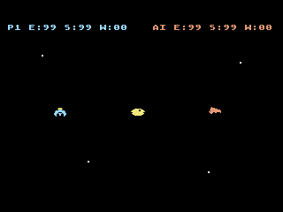

# Spacewar 7800

An authentic port of Bill Seiler's legendary 1985 DOS classic *Spacewar* for the Atari 7800 ProSystem, supercharged with the **AstroCart FPGA MathUnit & CORDIC Co-Processor**.

[](https://jasonfrowe.github.io/Spacewar_7800/)

**[▶ Play it in your browser](https://jasonfrowe.github.io/Spacewar_7800/)** (keyboard or gamepad), or on [jasonrowe.org](https://jasonrowe.org/Atari7800/spacewar/). It runs in [js7800_astrocart](https://github.com/jasonfrowe/js7800_astrocart), an Atari 7800 emulator with the AstroCart's math unit and second POKEY.

Written in [7800basic](https://github.com/7800-devtools/7800basic) and 6502 assembly, with full Maria high-resolution 320A graphics, two-channel TIA stereo sound, real-time Newtonian $1/r^2$ gravity physics, and an intelligent computer autopilot.

---

## Heritage: Bill Seiler's 1985 DOS Spacewar

In 1985, Bill Seiler published *Spacewar* for MS-DOS (IBM PC/XT/AT with CGA/EGA graphics). Descended from Steve Russell's original 1962 PDP-1 Spacewar! and the 1977 Cinematronics *Space Wars* vector arcade game, Seiler's version stood out for its tactical depth:
- **Two distinct warships**: The sleek, nimble **Needle** and the stout, armored **Wedge**.
- **Dual weapon arsenals**: Fast line-of-sight **Phasers** and lethal ballistic **Photon Torpedoes**.
- **Energy and Shield Dynamics**: Ships have limited reactor energy powering thrusters, weapons, deflector shields, and cloaking.
- **Central Gravitational Sun**: Dynamic inverse-square orbital mechanics allowing gravity-whip maneuvers, elliptical orbits, or fiery death in the sun's corona.
- **Autopilot AI**: A capable single-player computer opponent that navigates gravity, predicts intercept vectors, and leads shots.

**Spacewar 7800** brings this entire tactical experience to the Atari 7800, maintaining faithful physics, controls, and gameplay while leveraging the AstroCart hardware co-processor for real-time floating/fixed-point vector calculations.

---

## Features

- **Game Modes**:
  - **1 Player vs CPU**: Battle against the computer autopilot AI.
  - **2 Players Head-to-Head**: Pure tactical dogfighting on two joysticks.
- **AstroCart Hardware Acceleration**:
  - **CORDIC Engine ($0420-$042F)**: Instant vector rotation for 16-heading ship rendering, thrust impulse resolution, and Cartesian-to-polar target tracking.
  - **Arithmetic MathUnit ($0430-$043F)**: Instant 32/16-bit dual division for true $F = G \frac{M}{r^2}$ Newtonian gravity without lookup tables or slow software math loops.
- **Rich Maria Graphics**:
  - High-resolution 320A mode (320x240 effective resolution).
  - 16 rotational sprite frames per ship with subpixel inertia smoothing.
  - Animated solar corona, photon torpedoes, phaser beams, thrust plumes, and multi-stage explosions.
  - Real-time on-screen HUD displaying Energy, Shields, and Match Scores.
- **Dynamic Arena Physics**:
  - Selectable Gravity: Normal Sun (Newtonian attraction), Anti-Gravity (Repulsor Sun), or Zero Gravity (Deep Space).
  - Selectable Boundaries: Screen wrap-around (toroidal space) or elastic boundary bounce.
- **Full TIA Audio**:
  - Dual-channel synthesizer: Rocket thrust rumbles, resonant phaser chirps, torpedo launch harmonics, hull impact alarms, hyperspace warps, and explosive death detonations.

---

## Ship Specifications

| Specification | Needle | Wedge |
|---|---|---|
| **Role** | Swift Long-Range Cruiser | Heavy Armored Interceptor |
| **Max Speed** | Fast (High top speed) | Moderate (Higher inertia) |
| **Turn Rate** | 16-point rapid rotation | Heavy rotational momentum |
| **Primary Weapon** | Photon Torpedoes (Ballistic) | Phasers (High-velocity bolts) |
| **Secondary Weapon** | Phasers (Energy drain) | Photon Torpedoes (Spaced salvo) |
| **Special Systems** | Deflector Shields, Cloaking | Deflector Shields, Hyperspace |
| **Reactor Energy** | 99 Energy Units | 99 Energy Units |

---

## Controls

The game supports standard Atari 7800 two-button ProLine joysticks:

| Control | Action |
|---|---|
| **Joystick Left / Right** | Rotate ship counter-clockwise / clockwise |
| **Joystick Up** | Fire main rocket thrusters (consumes energy) |
| **Joystick Down** | Toggle Deflector Shields (drains energy while active) |
| **Button 1 (Left)** | Fire Primary Weapon (Photon Torpedo or Phaser) |
| **Button 2 (Right)** | Fire Secondary Weapon / Activate Hyperspace |
| **Console SELECT** | Toggle Options (1P/2P, Gravity Mode, Arena Boundaries) |
| **Console RESET / Fire** | Start / Restart Game |

---

## System Requirements & Emulation

### Hardware
- Atari 7800 ProSystem (NTSC or PAL).
- **AstroCart V4 Hardware Cartridge** with MathUnit & CORDIC co-processor FPGA bitstream.

### Emulation
- **A7800 / MAME**: Requires the AstroCart-enabled emulator build (branch `cordic` or later) at `/Users/rowe/Software/a7800/mame64`.
- **Command line**: Always pass `-nomouse` to prevent cursor capture:
  ```bash
  /Users/rowe/Software/a7800/mame64 a7800 -cart build/spacewar.a78 -nomouse
  ```

---

## Project Structure

```
Spacewar_7800/
├── build/                 # Compiled ROM binaries (spacewar.a78, spacewar.bin)
├── docs/                  # Detailed architectural & gameplay documentation
│   ├── DESIGN.md          # 1985 DOS comparison, game design & flight dynamics
│   ├── ENGINE.md          # 7800basic & Maria display architecture, TIA audio
│   ├── MANUAL.md          # Classic Atari 7800 instruction manual booklet
│   └── MATHUNIT.md        # FPGA MathUnit & CORDIC co-processor specification
├── src/                   # Game source code
│   ├── spacewar.bas       # 7800basic main loop, HUD, state management
│   ├── asm/               # 6502 assembly engines
│   │   ├── physics.asm    # MathUnit CORDIC physics, gravity, collisions
│   │   ├── sound.asm      # 2-channel TIA audio driver
│   │   └── ai.asm         # Computer autopilot decision engine
│   └── gfx/               # 1-bit 320A PNG graphics and font
└── tools/                 # Build scripts and utilities
    ├── build.sh           # Master build script
    ├── play.sh            # One-click test launcher for MAME
    ├── mkgfx.py           # Procedural sprite generator for 320A ships & effects
    └── a78math.py         # AstroCart header signature utility ('ACM')
```

---

## Building from Source

### Prerequisites
- Python 3 with `Pillow` (for sprite generation).
- 7800basic v0.40+ (included in `tools/7800basic` or system PATH).
- `wasmtime` runtime for running the 7800basic toolchain.

### Build Command
Run the build script from the repository root:
```bash
./tools/build.sh
```

To run immediately in the emulator:
```bash
./tools/play.sh
```

---

## License

Licensed under the GNU General Public License v3.0 (GPL-3.0). See [LICENSE](LICENSE) for details.
Bill Seiler's original 1985 DOS Spacewar is acknowledged as the design inspiration.
